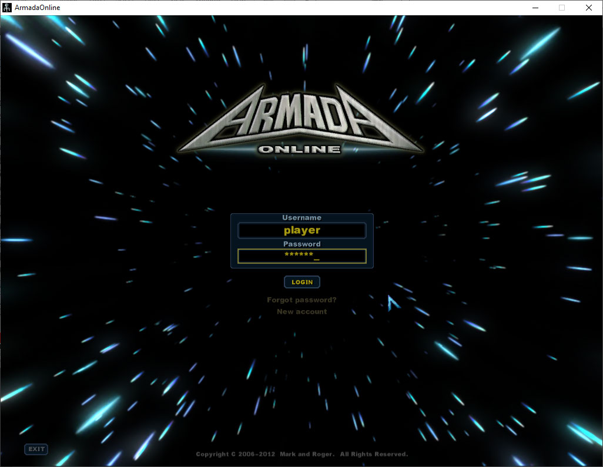
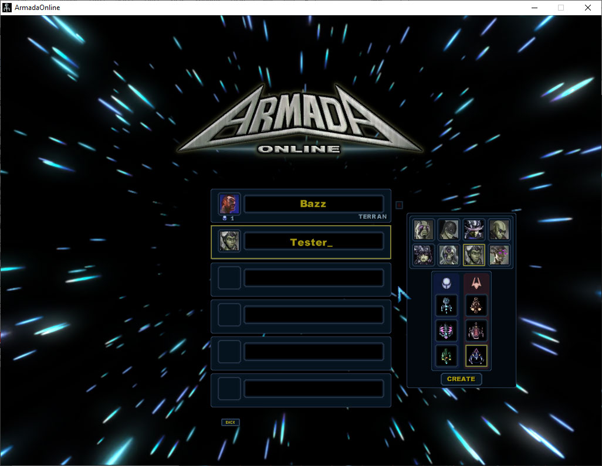
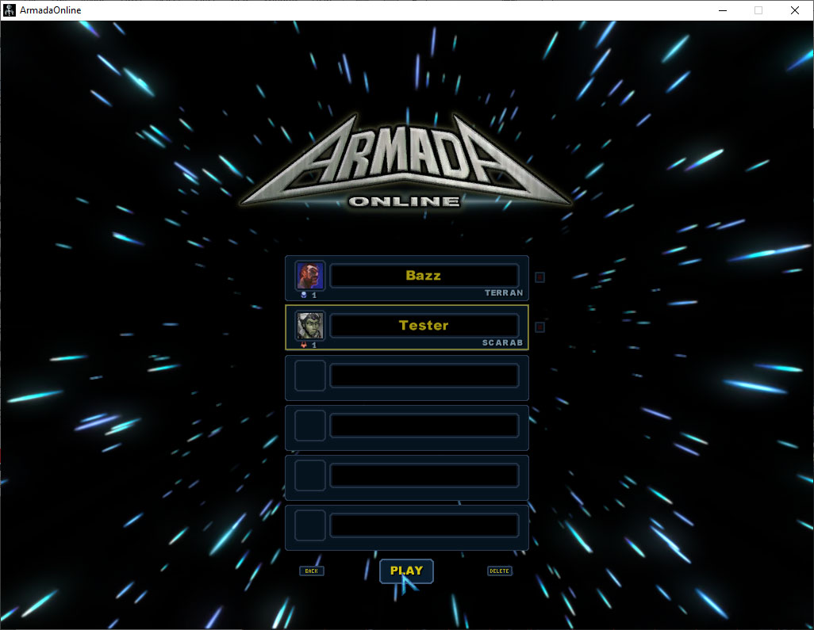
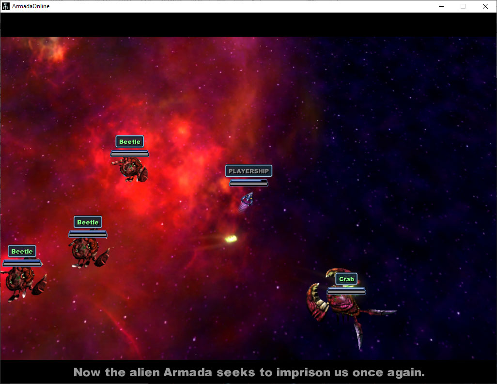
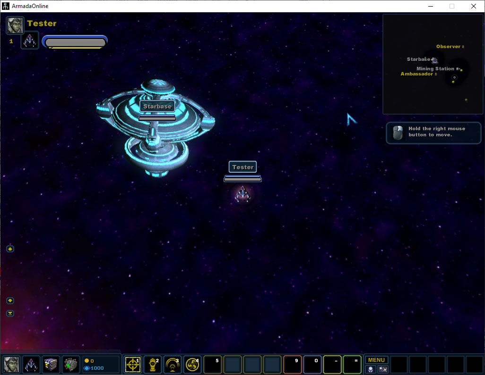
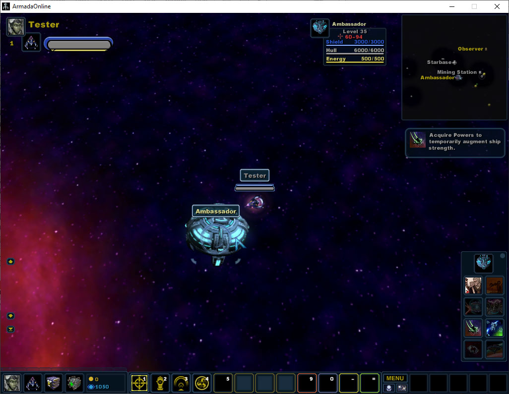
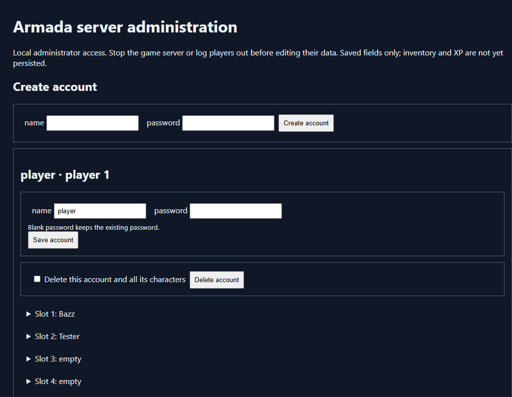

# Armada_SEMU

 

A local Armada Online server emulator for the original game client. Python 3.10 or newer is required. All server dependencies are in the Python standard library; no pip packages or virtual environment are needed.

## Emulator version

Current release: **0.1.0-alpha.2**. Emulator versions are separate from the original game client's August 23, 2012 date. `Server_Emulator/version.py` is the version source; run `python Server_Emulator/server.py --version` from this folder to display it. The same version appears in server startup output and the account admin page. See [CHANGELOG.md](CHANGELOG.md) for release history and versioning rules.

## About Armada Online

Armada Online is a Windows science-fiction action RPG in which players pilot a single starship, explore space and battle the Armada's biomechanical aliens. The original game combines cooperative multiplayer combat with tactical abilities, captain and ship customization, and strategic battle zones involving station placement, starbase defense and opposing player teams. Its historical open-alpha description mentions tier-three ships and a level cap of 40, with additional ships, zones, missions and story content planned. These describe the original game rather than a list of completed emulator features. Source: [Armada Online on ModDB](https://www.moddb.com/games/armada-online).

This project targets the original alpha client, with an executable date of August 23, 2012 (08-23-2012). That client-version date is separate from ModDB's installer upload date: the [Armada Online Alpha Installer listing](https://www.moddb.com/games/armada-online/downloads/armada-online-alpha-installer) records October 4, 2012 for `armadaonlinealpha.msi`. The executable date and the later installer upload date refer to different things.

## Project folders

- `Server_Emulator/` — server code, Windows launchers, tests, account database, backups and runtime logs.
- `Original_Installer/` — original game installer.
- `Patched_Client/` — patched game executable and reversible client backups.
- `screenshots/` — game and admin screenshots used in this README.
- `docs/` — README version pill and save-protocol documentation.

## Install and play (Windows)

1. Install Python 3.10 or newer if it is not already installed. Enable the Python installer's PATH option so `python` works from a command prompt.
2. Open `Original_Installer` inside this folder and run `armadaonlinealpha.msi`. If you need the installer, download it from the [Armada Online Alpha Installer page on ModDB](https://www.moddb.com/games/armada-online/downloads/armada-online-alpha-installer). Follow the installer to install Armada Online, then locate the game installation folder containing `ArmadaOnline.exe` and its resource files.
3. Copy `Patched_Client/ArmadaOnline_local.exe` into that game installation folder, alongside the original executable. Keep its filename and launch this patched executable to play on the local server. If you installed an earlier patched client, copy this updated version again: it includes the new save support. It needs the installed game's resources; do not run it directly from `Patched_Client`.
4. Open `Server_Emulator` inside `Armada_SEMU` and run `run.bat`. Keep the server window open while playing. The game service listens on UDP `127.0.0.1:8101`, and the account admin page starts with it.
5. Open [http://127.0.0.1:8102/](http://127.0.0.1:8102/) in your browser. Under **Create account**, enter a login name and password, then click **Create account**. You can also manage existing accounts and characters on this page.
6. Launch `ArmadaOnline_local.exe` from the game installation folder. Log in with the account you just created, create or select a character, and enter the game. Run the game and server on the same computer because the current services use loopback addresses.
7. When finished, close the game and press **Ctrl+C** in the server window to stop the server.

You can also start the server with `python Server_Emulator/server.py` from the `Armada_SEMU` folder, or run `python server.py` from `Server_Emulator`. No pip packages or virtual environment are required. The supplied installer and patched client are in `Original_Installer` and `Patched_Client`; the server does not modify either executable during startup.

Options: `--port 8101` changes the UDP port; `--admin-port 8102` changes the browser port; `--no-admin` disables browser administration. Diagnostic `--spawn-x X --spawn-z Z` overrides entry coordinates; supply both together. Both services accept connections only from this computer.

## Game screens

After creating your account in the browser, launch the patched client and enter your username and password on the login screen.

Choose an empty character slot to create a captain, select the available portrait and ship options, and click **Create**.

Select your character and click **Play** to enter the game.

A new character can see the opening story cinematic before entering the starter area.

The starter area includes the Starbase, your ship, the minimap and movement tutorial hints.

Visit nearby facilities to view available powers. This example shows the Ambassador selected and its power offerings open.

## Accounts and characters

The admin page creates, renames, resets passwords for, and deletes game login accounts. Blank passwords on edits preserve the existing password. Login names accept 1–15 ASCII letters, digits and underscores; passwords accept 1–15 ASCII characters, matching the client packet limits. Passwords are salted PBKDF2 hashes, never displayed in the page.

Each account has six character slots. Expand a slot to create or edit its name, race (0–5), ship ID (0–63), intro completion flag (0 or 1), sector and saved coordinates. Sector accepts 1–5 or 50–52; empty sector/coordinates use the original startup behavior. Position is the saved entry checkpoint. Last target coordinates are movement destinations, not current position. Numerical ship IDs are accepted by the existing protocol; not every race/ship combination has been verified in the game.

Deletion requires checking a confirmation box. Deleting an account also deletes its characters. Every successful admin mutation creates a SQLite backup in `Server_Emulator/data/backups/`. Account and character edits take effect on the next game login; log affected players out before editing or deleting their data. The local admin page has no separate password: anyone with access to a browser on this computer can administer it. Forms use anti-CSRF tokens and reject foreign origins/hosts.

`Server_Emulator/data/accounts.sqlite3` was copied using SQLite's backup API from the existing ArmadaLocalServer database. Existing account credentials and character records are preserved. ArmadaLocalServer remains available separately; the two folders have independent databases. Run only one game server on the same UDP port. Do not continue switching between the two copies if you want a single evolving save database.

## Current behavior

Game login and character creation work. The original starter sector 3 loads its client resources, including stations, crystals and enemies. The correct map, help screen, movement, combat and loot collection have been verified in the original client. The relay supports movement/target actions, shop power purchases and relinquishing powers in the five ship power slots. Purchase/removal fixes have protocol tests; full live-client confirmation remains necessary. The zero beneath a selected crystal is its required mining skill, not a collected crystal count.

Character saves now retain the original character and personal-data blocks, including stored currency/resource fields, inventory, skills, ship progression and other serialized fields. The updated patched client also saves the resource balance shown during gameplay, all five active shop power slots and the actual ship position. Movement destinations remain separate. Returning-character intro completion is signalled through the recovered login field. Save uploads and restore responses support reliable fragmented packets. Gameplay still uses the original client's simulation and resource definitions; authoritative multiplayer simulation and full progression behavior remain incomplete. Server timing instrumentation distinguishes processing time from the client's approximately half-second synchronization interval.

The admin editor edits account credentials and character identity/location fields. Gameplay snapshots are stored separately; the editor shows their last save time, saved resource balance and active power count, but does not expose inventory or mission editing. Test spawning, cinematic behavior, power purchases/removal, save restoration and mining effects in the original client before treating them as fully verified.

## Saving and loading characters

Use the updated `Patched_Client/ArmadaOnline_local.exe` together with this server. Saves are automatic: the patched client uploads a snapshot every 300 simulation ticks (approximately ten seconds at the normal simulation rate), and requests a final snapshot before changing sectors or logging out normally. The next character load restores the latest committed snapshot. There is no separate save-file picker.

The database retains the complete original character block and any uploaded personal-data block rather than discarding fields whose meanings have not yet been decoded. A versioned client extension also preserves the gameplay resource balance, five active shop powers, and X/Z position. The normal integer sector-entry coordinates use the nearest whole coordinate from the saved position. Removed powers are saved as empty slots. Powers are restored directly rather than purchased again, so the restore path does not charge their purchase price a second time.

Refresh the account admin page and expand the character slot to check its last gameplay save time, balance and active power count. Keep the server running until the final upload completes. An abrupt game or server termination can lose changes since the latest committed autosave. Existing account/character records are preserved, and schema upgrades create database backups under `Server_Emulator/data/backups/`. Progress from earlier emulator sessions that never uploaded a snapshot cannot be recovered retroactively.

The patched executable has been updated only in `Patched_Client`; the installed game executable must be replaced by copying the updated file again. Previous patched versions are backed up in `Patched_Client/backups/`. The original installer and original game executable remain unchanged. Older local clients can use the original snapshot format but cannot save or restore the extension's balance and active powers.

Live-client verification is required for the new client hooks: change a balance, buy a power, move the ship, wait for an autosave, then log out and reload the character. Check that balances, power slots and position match. Repeat after relinquishing a power, switching characters and restarting the server. Mission-specific progress and all original game modes have not been exhaustively verified.

## Files and tests

All server source files and launchers are in `Server_Emulator`. Within that folder, `server.py` runs UDP and starts `admin.py`; `persistence.py` handles save/restore layouts and `fragments.py` handles bounded packet reassembly; `login.py` manages authentication and SQLite migrations; `protocol.py` implements packet encoding; `world.py` handles map entry and command relay. `Server_Emulator/data/maps.json` and `Server_Emulator/data/schema.sql` contain map metadata and the fresh database schema. Runtime logs are created in `Server_Emulator/logs/` and contain metadata rather than credentials. `.gitignore` excludes generated data and logs, including personal accounts, saves and backups; only `maps.json` and `schema.sql` are included from the data folder. Implementation notes are in [SAVE_PERSISTENCE.md](docs/SAVE_PERSISTENCE.md).

Tests are in `Server_Emulator/tests/`. Run `test.bat` from `Server_Emulator`, or run `python -m unittest discover -s tests -t . -v` in that same folder. Tests cover packet handling, relay regressions, map entry, account CRUD, character changes, password compatibility, browser form protection, snapshot preservation, fragmented save/reload, delayed final saves and client patch signatures. Tests use temporary databases. To restore a backup, stop the server first, preserve the current database, and copy the selected backup over `Server_Emulator/data/accounts.sqlite3`.

